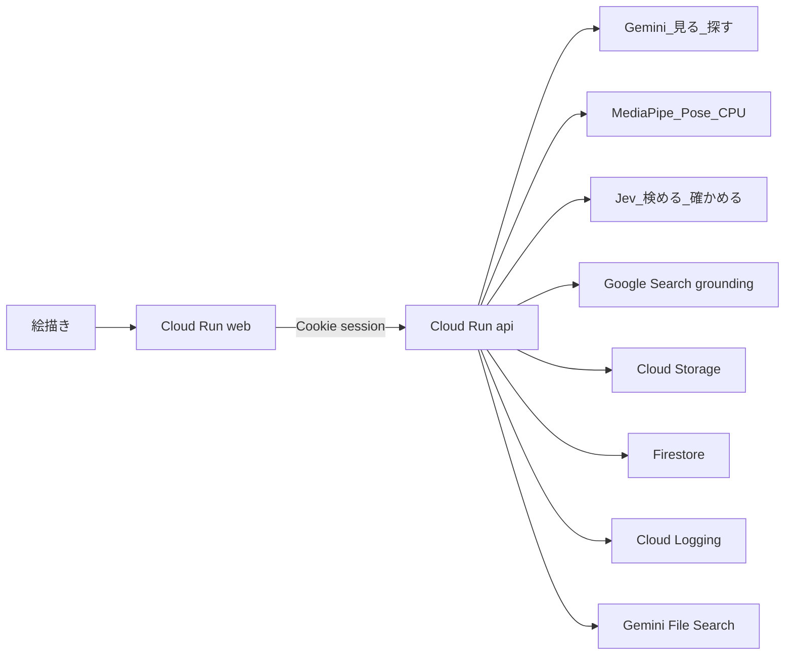
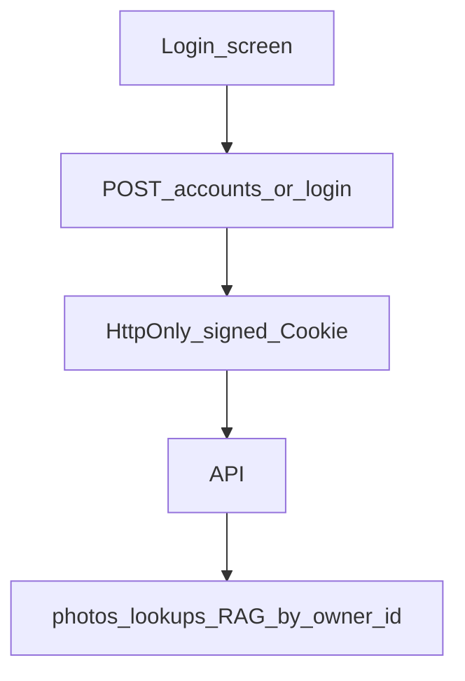

# Google Cloud 設計

正本はプロダクトが [idea.md](../idea.md)、いまのクラウド設定が [status.md](deploy/status.md)、キー名が [env-contract.md](deploy/env-contract.md)。このファイルは、どのクラウド部品が何をするか。

確認日: 2026-09-19。UI の色やフォントはここには書かない。

## 大会に合わせた決め

| 大会の条件 | この設計 |
|------------|----------|
| 実行プロダクトが1つ以上 | Cloud Run を2つ（画面と API） |
| Google Cloud の AI が1つ以上 | Gemini Enterprise Agent Platform。`GOOGLE_GENAI_USE_ENTERPRISE=True` |
| ローカルだけでは不可 | 審査用 URL は Cloud Run |
| 約3分の動画で伝わる | サンプル写真 → 層と関節 → 出典履歴の1本 |
| 自律性・制御・記録 | 見る、検める、探す、確かめる、残すを API がやり、ログに段を出す |
| ソーシャルログインは避ける | メール／Google 必須にしない。最初の画面でユーザー名とパスワード。ログイン後に作業画面 |
| セキュリティ（隔離） | 写真・履歴は `owner_id`（セッション）単位。ユーザー間共有しない |
| 秘密を Git に置かない | 本番は ADC。キーはブラウザに出さない |

## 使うもの

| 部品 | 役割 | 今 |
|------|------|----|
| Cloud Run `web` | 操作画面。ポート 3000 | 必須 |
| Cloud Run `api` | 写真の解析、検索、履歴。ポート 8000 | 必須 |
| Gemini（Agent Platform） | 写真から物体の呼び方。選んだ呼び方の検索出典。座標推定には使わない | 見る段の名前、探す段 |
| Cloud Speech-to-Text | ポーズの短い録音を文字にする。その文字は既存の言葉ポーズへ渡す | マイク。音声は API だけ |
| MediaPipe Pose full（CPU） | 見えている関節。モデルが無ければ lite に落とす | API コンテナに `.task` 同梱 |
| MediaPipe Hand Landmarker（CPU） | 写っている手の指。無いときは指を補完 | `hand_landmarker.task` 同梱 |
| MediaPipe Image Segmenter（CPU） | 人の前景マスク。写っている部分だけの輪郭 | `selfie_segmenter.tflite` 同梱 |
| Jev（TypeSafe） | 枠と関節を出すか。引用が権利を書いているか | テキストだけ。写真は送らない |
| Gemini API File Search | 手元資料の意味検索。人ごとにストア1つ。`RAG_ENABLED=true` のときだけ | Developer API のキー。RAG Engine は使わない |
| Google Search grounding | 選んだ物体のウェブ出典 | 探す段の Gemini に付く |
| Cloud Storage | 上げた写真。公開バケットにしない | 必須 |
| Firestore | 出典履歴（URL、ライセンス、時期、著作権） | 必須 |
| Cloud Logging | 見る / 検める / 探す / 確かめる / 残す の記録 | 必須 |
| RAG Engine | 使わない。常時の Spanner 料金がデモに合わない | — |

ブラウザから Gemini を呼ばない。画面は `NEXT_PUBLIC_API_BASE_URL` だけを知る。

OSS と外部サービスの表記は画面の `/licenses`（静的。API は無い）。再生成は `scripts/generate_third_party_notices.py`。依存の自動更新は置かない。

## 全体

File Search は、その人のストアだけを検索する。RAG Engine は使わない。ウェブ上の PDF は取りに行かない。

## セッションとテナント隔離

主催者方針: ゲストのように入れるが、**ユーザー間でデータが共有される設計は減点**。Firebase Auth / Supabase はハッカソン提出物では使わない。

| 項目 | 内容 |
|------|------|
| 入り方 | 未ログインでは作業画面を出さない。`POST /accounts` でユーザー名とパスワード（メールなし。ユーザー名は一意。パスワードは一意にしない）。`POST /accounts/suggestions` は空いている名前を1つ返す。`POST /accounts/login` で同じアカウントに戻る。`POST /accounts/logout` で Cookie を消す。審査用アカウントは画面とリポジトリにパスワードを出さない。ログインしない試用は無い。本番の画面は `/drawref-api` を API へ転送し、ブラウザは画面と同じオリジンだけを呼ぶ |
| 認可単位 | アカウントの `owner_id`。写真・出典履歴・チャットはこの配下。審査用以外のアカウント同士は共有しない |
| 共有してよいもの | 読み取り専用のサンプル写真カタログのみ。解析結果は各セッション内 |
| 禁止 | 固定共有デモアカウント、`photo_id` だけの横断読み取り、クエリの `user_id` なりすまし |
| 公開後 | 端末内継続で足りるならセッションのまま可。別端末のアカウントが必要ならそのとき IdP を足す |

## エージェントの1回

1. **見る.** MediaPipe Image Segmenter で人の前景マスク（写っている範囲だけ）を輪郭にする。マスクは1枚のまま。MediaPipe Pose full は最大4人の関節を取り、左から右に並べる。人が小さいときは、周りを余裕付きで元画像から切り出して関節を取り直す。誰も十分な大きさで見つからないときは、重なる4区画でも探す。画面のカメラは、頭から足が入る枠を出す。MediaPipe Hand Landmarker の手は、近い手首の人に付ける。座標推定に Gemini は使わない。API の起動時に姿勢・手・輪郭のモデルを読む。そのあと Gemini が写真から呼び方だけを付ける。人は左から見た目（年齢の目安、分かるときだけ性別、衣服）。公開の人物だと分かるときだけ名前を足す。迷う名前は付けない。読める作品名・建物名・看板、または迷わず特定できる作品名だけ `work_title` に入れる。複数人で呼び方が無ければ「左からN人目」。場所・道具・動物は別物体（枠と関節は空）。名前が取れなければ1人は「人」のまま。同じ写真を Cloud Vision の Web Detection に1回渡し、この画像が載っている https ページを最大5件 `web_pages` にする。best guess のラベルは著作権検索に使わない。Vision が失敗しても解析は続ける。レスポンスの `pose.people` に人ごとの landmarks / muscles / mannequin を付ける。先頭の人は `pose.mannequin` にも入る。姿勢・輪郭・手は同時に取る。人形は先に返し、呼び方は縮小した写真で後から同じ `photo_id` に足す。画面は呼び方を待つ間も人形を動かせる。
2. **検める.** 見る段では Jev を使わない（専用モデルの点を言語判定で消さない）。出典の権利判定は探す段の Jev のまま。
3. **探す（自動）.** 見た目の呼び方ではウェブを調べない。公開人物名、`work_title`、画面で入力した題名か作者のうち、一般語でない最初の語だけを Gemini と Google Search grounding に1回渡す。どれも無ければ `search_skipped` で、題名か作者を入れるよう返す。写真は再送しない。同じ語で [ジャパンサーチ簡易 Web API](https://jpsearch.go.jp/static/developer/webapi/ja.html) のアイテム検索を最大3件足す。キーは不要。`common.contentsRightsType` がガイド 3.2.2.1 のコード値のときだけ `rights_code` に入れる。ライセンス文は作らない。ジャパンサーチが失敗しても grounding の結果は返す。同じ語のウェブ結果と権利コードはプロセス内で覚え、次はすぐ返す。資料庫はこの段では引かない。短いまとめと出典 URL を返す。ライセンス・時期・著作権は、出典本文にその文言があるときだけ残す。無ければ unknown（画面は未確認）。これは権利者の断定ではない。画面では似た資料と書く。掲載ページは探す段ではなく、見る段の `web_pages` である。
4. **探す（出典検索）.** 絵描きさんが「調べる」を押したときだけ。見た目の呼び方ではウェブを調べない。公開人物名、`work_title`、画面で入力した題名か作者のうち、一般語でない最初の語だけを Gemini と Google Search grounding に1回渡す。資料庫の本文は混ぜない。どれも無ければ `search_skipped`。写真は再送しない。同じ語でジャパンサーチの権利コードを最大3件足す。
5. **資料庫（チャット）.** 選んだ物体と質問とタグから、その人の File Search（外れは単語一致）だけを引く。資料庫は人に1つで、案件では区切らない。加えて、その人の作業メモ・チャット文言・出典記録から、質問と語が重なる抜粋を最大4件足す。選んでいる作業を先にする。同じ写真の直近6往復も渡す。それより古い往復は記録に残し、プロンプトには入れない。メモは File Search にもウェブにも出さない。チャットでメモ作成を頼んだときだけ、選んでいる作業のメモの末尾へマークダウンを足す。既存の文は消さない。当たった資料を最大4件返す。ウェブ検索と Jev はしない。返答の `memory` は繋いだ作業の抜粋。開いた資料の「出典を確認」は `POST /materials/{doc_id}/lookups`。題名か作者の指定、または本文の題名／作者の行だけを外へ出す。結果はその資料に `searched_at` つきで残す。`GET/PATCH /preferences` の `citation_refresh_days`（1〜365、初期値 30）より新しければ再検索しない。日数・言語・テーマ色はそのアカウントだけ。選んでいる案件があるときは、チャットで開いた資料と出典確認（その時点のライセンス・著作権・時期）を案件の記録へ足す。
6. **残す.** 自動検索とチャットの履歴を Firestore に書く。モデルは呼ばない。選んだ案件には、上げた写真、開いた資料、チャットの質問と返答、出典確認を最大40件ずつ残す。自由メモは案件に1つ、マークダウンのまま最大2万字。資料の実体は資料庫のまま。権利の断定はしない。

画面は元画像／マスク／骨格／筋肉／3D（Three.js）を切り替えられる。骨格と 3D は同じデッサン人形で、最大4人を写真上の位置のまま同時に出す。人ごとに色が違う。層で選んだ人だけ、頭身・手・曲げ・ねじれが変わる。写真の幅と高さの比を保つ。3D は Mixamo の体を2つから選ぶ（X Bot と人物。ファイルは `apps/web/public/dolls/`。商用利用できるフリー素材で、アプリのコードではない）。頭身・体つき・曲げ・ねじれ・手の開閉は、その骨格の向きと長さに渡す。写真の手前が体の正面になる。向きは、鼻の前後と肩の左右で機械的に決め、自信が低いときだけ Gemini に正面・背面・左・右のどれかを最大2回聞く。座標は返させない。左右が向きと矛盾するときは左右の関節を入れ替える。手足は、胴より長すぎる節と、枠に張り付いた手首・膝・足首を落とす。肘が反対の肩側にあるときだけ、Gemini に上がっているか隠れているかを最大2回聞き、2回とも同じときだけ腕の左右を入れ替える。座標は返させない。骨格の線と筋肉は、直した関節から作り直す。肩・肘・手首・股・膝・足首の球はドラッグ用に残す。体が読めないときだけ、従来のボリューム（頭は球、胸と腰は胴、四肢は円柱）に戻す。2D の骨格は線のまま。関節の曲げは 2D と 3D で共有する。写真に写っていない節は左右の反転か標準の比率で補完し、木色は写真、青は補完と色分けする。最初の人形はこの人の頭身と体つきのまま。骨格と 3D で頭身（9〜4）と体つき（細身、標準、がっしり、肩広・腰狭、肩狭・腰広）を別々に替えられる。姿勢（曲がり方）は共通で、頭身を替えると頭・胴・手足の長さと太さを一緒に変える。手は開く・自然・握る。3D は正面・斜め・横・後ろ。肘と膝は逆側へ折れない。画面は1〜4枚を並べられる。枚数を増やすと、新しいマスは別角度の3Dになる。各マスは元画像、マスク、骨格、筋肉、3Dから自由に選べ、3Dは正面・斜め・横・後ろをマスごとに変える。同じ角度を複数マスにしてもよい。姿勢の操作は全マスで共通。操作は「体」（体の形、頭身・体つき・手）、「線」（頭身の目盛りと重心線。それぞれオンとオフ。透視はオフ、アイレベル、1点、2点。線と消失点はドラッグ。3Dマスには出さない。写真を反転すると、元画像・補助線・人形が一緒に左右反転する。色を抜くと元画像だけ白黒になる）、「向き」（左右反転、肩と腰のねじれ、姿勢を戻す）に分かれる。骨格と筋肉では人形の濃さを下げ、写真とのずれを見られる。目盛りと重心線は濃さでは薄くならない。これらは画面上の操作で、保存しない。手検出が無いときは指全体を補完する。顔の点は描かず、頭は1つ。奥行きは肩幅に対して正規化する。医学的正確さは保証しない。

写真が無いときも、言葉から同じ人形を出せる。マイクの録音は Cloud Speech-to-Text が文字にし、同じ言葉の経路に渡す。聞き取れないときは入力に戻す。デッサンでよく使うポーズはコード内の一覧に約10種あり、言葉が当たれば Gemini を呼ばず候補を返す。データベースは使わない。当たらない言葉だけ Gemini が関節 ID と角度（度）を最大3つ作り、同じ言葉はプロセス内で覚え直す。知らない関節は捨て、範囲外は切る。画面は候補を選び、立ち姿の人形へその角度を足す。写真があるときは、選んでいる人の曲げだけを替える。絵は生成しない。

ピクセル単位の解剖テクスチャ生成や Hugging Face GPU 推論はしない。MediaPipe は公式 `.task` を Docker／ローカルに同梱するだけ。Jev は出すかと％を返す。

## API

JSON は snake_case。失敗は `{ "error": { "code", "message" } }`。

| メソッド | パス | すること |
|----------|------|----------|
| GET | `/health` | 死活。セッション不要 |
| POST | `/accounts/suggestions` | 未使用のユーザー名を1つ返す。予約しない。セッション不要 |
| POST | `/accounts` | アカウント作成（`username`, `password`）。メールなし。Cookie |
| POST | `/accounts/login` | ログイン。失敗は 401。Cookie |
| POST | `/accounts/logout` | Cookie を消す。セッション不要 |
| POST | `/sessions` | ログイン済み Cookie の継続だけ。ゲストの新規 ID は発行しない |
| GET | `/sessions/me` | 現在のセッション。無ければ 401 |
| POST | `/photos` | 写真を受け、必要なら JPEG に直してから、層・輪郭・`pose`・`file_facts`・`web_pages` を返す。任意フォーム `project_id` があると、その案件の記録に写真 ID を足す。セッション必須 |
| GET | `/photos/{photo_id}` | 同じ写真の層・姿勢・`file_facts`・`web_pages`。所有者のみ |
| POST | `/poses` | 言葉を既存の関節角度だけにする。座標は返さない。登録に当たれば `pose_source=catalog`。外れだけ Gemini。`options` は最大3候補。セッション必須 |
| POST | `/photos/{photo_id}/lookups` | 自動検索。まとめと出典 URL。任意で `query`（題名か作者）、`tags` / `project_id`（手元 RAG 用）。所有者のみ |
| GET | `/photos/{photo_id}/lookups` | 自動検索の履歴一覧。所有者のみ |
| POST | `/photos/{photo_id}/questions` | 資料庫、作業の記録、同じ写真の直近6往復から答える。`materials` と `memory`。ウェブ出典は空。任意で `tags`。`project_id` は検索の絞り込みではなく、開いた資料とチャット文言の記録。選んでいる作業の抜粋を先に返す。所有者のみ |
| GET | `/photos/{photo_id}/questions` | チャット履歴一覧。所有者のみ |
| GET | `/materials/{doc_id}` | 資料の本文（索引テキスト）。所有者のみ |
| POST | `/materials/{doc_id}/lookups` | その資料の出典検索。保存が日数以内なら再検索しない。`query` が空なら本文の題名か作者の行だけ。任意 `project_id` で、その時点の権利記録を案件へ残す。所有者のみ |
| GET | `/preferences` | `citation_refresh_days`、`locale`（ja / en）、`theme_id`。所有者のみ |
| PATCH | `/preferences` | 再検索までの日数（1〜365）、言語、テーマ色。送った項目だけ更新。所有者のみ |
| POST | `/materials` | 手元資料の登録（クエリ: `material_kind` 必須、任意 `project_id`）。所有者のみ |
| GET | `/materials` | 手元資料一覧（任意 `project_id` で絞り込み）。`tags`（owner 内の既存タグ）も返す。所有者のみ |
| PATCH | `/materials/{doc_id}` | `tags` / `project_id` の更新と再索引。所有者のみ |
| DELETE | `/materials/{doc_id}` | 手元資料の削除。所有者のみ |
| GET | `/projects` | 案件一覧。`photos` / `library_calls` / `citations` を含む。所有者のみ |
| POST | `/projects` | 案件作成（`name`）。所有者のみ |
| POST | `/projects/{project_id}/library-calls` | 手で開いた資料（`doc_id`）を記録。所有者のみ |
| PATCH | `/projects/{project_id}` | 自由メモ `memo`（最大2万字、マークダウンのまま）。所有者のみ |
| DELETE | `/projects/{project_id}` | 案件削除（配下に資料が無いときだけ）。所有者のみ |

`lookups` の各出典:

| フィールド | 中身 |
|------------|------|
| `url` | 出典 URL |
| `title` | ページ名。無ければ空 |
| `rights_code` | ジャパンサーチの `contentsRightsType`。当たったときだけ。写真の権利者ではない。`license` には入れない |
| `protection_until` | 出典の `created` にある西暦のうち、今年以前でいちばん新しい年から70年後の12月31日。年が無ければ `unknown`。ライセンスの判断には使わない |

`questions` の各出典:

| フィールド | 中身 |
|------------|------|
| `url` | 出典 URL |
| `title` | ページ名。無ければ空 |
| `license` | 文に書いてあればその文字列。無ければ `unknown` |
| `created` | 作成時期。無ければ `unknown` |
| `protection_until` | `created` の西暦のうち、今年以前でいちばん新しい年から70年後の12月31日。無ければ `unknown` |
| `copyright` | 著作権の記載。無ければ `unknown` |
| `jev` | `{ about, license, created, copyright }`。各 0〜100 の整数、または `null` |
| `material_kind` | `web` \| `own_work` \| `third_party` |

Grounding を使う応答では、API が返した Search Suggestions を画面に出す。出さないと利用条件を満たさない。出典: [Grounding with Google Search](https://docs.cloud.google.com/gemini-enterprise-agent-platform/models/grounding/grounding-with-google-search)。

ページ全文を別途クロールしない。ライセンスがスニペットに無ければ未確認のまま。

`file_facts` はアップロードしたファイルの EXIF / IPTC / XMP と、C2PA の記録の有無だけ。項目は `artist`、`copyright`、`copyright_url`、`image_id`、`credit`、`c2pa`（`present` または `absent`）、`c2pa_generator`。無い文字列は `unknown`。署名の検証はしない。画素に焼き付いた透かしは読まない。位置情報は返さない。空でも自由利用ではない。

`web_pages` は Cloud Vision Web Detection の `pagesWithMatchingImages`。`url` と `title`。https だけ、最大5件。この画像の掲載場所であり、権利者の断定ではない。認証は ADC。新しい API キーは置かない。失敗時は空配列。

## データ

- `GCS_BUCKET` があるとき、写真の実体と手元資料のファイルは Cloud Storage `illustration-support-photos`（大阪 `asia-northeast2`、公開禁止）。パスは `owners/{owner_id}/photos/...` と `owners/{owner_id}/materials/...`。写真の解析結果・出典履歴・資料メタデータ・案件は、同じプロジェクトの Firestore `(default)` で `owners/{owner_id}/...` に書く。未設定のときはプロセス内と `apps/api/.data/materials/`（テストとローカル簡易）。
- バケットは非公開。ブラウザへは API 経由の短命な表示だけ。署名 URL の全文はログに出さない。
- Firestore の履歴に写真の画素や PDF 本文は入れない。資料の検索用テキスト（索引）だけを資料ドキュメントに置く。
- 他人の `photo_id` を推測しても、`owner_id` 不一致なら存在を明かさず 404 相当（業務エラー `object_not_found`）。

## セキュリティ

- 本番の Gemini（見る・探す・姿勢の言葉）は Cloud Run のサービスアカウント（ADC）。手元資料の意味検索だけは Gemini Developer API で、サーバーの `GEMINI_API_KEY` か `GOOGLE_API_KEY` を使う。ブラウザには置かない。
- セッション Cookie は `SESSION_SIGNING_SECRET` で HMAC 署名。秘密と Cookie 全文はログに出さない。
- ログに出してよいのは、処理段、モデル名、出典 URL、`unknown` かどうか。画像バイト、キー、署名 URL は出さない。
- こちらから本をダウンロードしない。Kindle の非公式取得もしない。
- 解析写真の受け取りは 100MB まで。JPEG / PNG / WebP で 10MB 以下ならそのまま使う。それ以外は JPEG に直してから解析する。100MB 超と、画像として読めないファイルだけ業務エラー。Gemini の失敗はシステムエラーとして同じ形で返し、中身はログだけ。
- CORS は本番オリジンに限定し、Cookie 送受信のため credentials を許可する。

## 手元資料（RAG・material_kind）

登録画面は `/library`。二領域ドロップで `own_work`（自分の作品）と `third_party`（他者の資料）を申告する。AI は種別を推測しない。

| ルール | 内容 |
|--------|------|
| 保存パス | `owners/{owner_id}/materials/{material_kind}/{doc_id}/...`。`GCS_BUCKET` があるときは Cloud Storage。無いときは `apps/api/.data/materials/` |
| 原寸上限 | 手元資料は 100MB／ファイル。解析写真も 100MB まで受け、10MB を超えるものや JPEG / PNG / WebP 以外は JPEG に直してから解析する |
| 形式 | JPEG/PNG/WebP、PDF、docx、xlsx、md、txt |
| 索引 | 画像は長辺約 2048px の派生物。Office／テキストは本文抽出。原寸は GCS（またはローカル）に残す。検索テキストは Firestore の資料ドキュメント。`RAG_ENABLED=true` のとき、同じ本文をその人の Gemini API File Search ストアへも上げる |
| 意味検索 | 人ごとにストア1つ。問い合わせはそのストア名だけ。返った断片は、その人の `doc_id` に一致するものだけ残す。空なら単語一致に戻る。RAG Engine は使わない。キーが無い、または `RAG_ENABLED` が無いときは単語一致だけ |
| 案件 | 作業の記録。写真 ID、開いた資料、チャットの質問と返答、出典確認（その時点の権利文）を最大40件。自由メモは1つ。資料庫の仕切りには使わない |
| タグ | 人が付ける `tags: string[]`（例 `OC:アオ`）。索引先頭に `tags: ...` を連結。AI 自動分類はしない |
| コーパス | owner ごと。横断禁止。案件のユーザー間共有もしない |
| 自動提示 | チャットは資料庫だけを開く。出典検索は「調べる」と、開いた資料の「出典を確認」だけ。結果は混ぜない |
| 著作権 | Jev に `material_kind` を渡す。`own_work` は関連％＋`own_claim`（権利 Noul なし）。`third_party` / `web` は引用＋権利 Jev（指示に区分を含める） |
| セッション上限 | 30件または合計 2GB |
| 禁止 | 全ユーザー共有コーパス、カメラ RAW の直接登録、タグ／種別の AI 自動分類 |

検索は、その owner の File Search ストアに対する意味検索が先。当たらなければ索引テキストの単語一致。ストア名は Firestore の owner ドキュメント（クラウド時）かプロセス内。文書名は資料メタデータの `file_search_document`。画面には出さない。

## 個人補助・編集者向け（Studio）

Must 外。デモを速くするための手元作業。

| 機能 | どこ | 永続 |
|------|------|------|
| 使うタグ・作業の記録 | タグはチャットの問い合わせに足す。案件は写真・開いた資料・出典確認の記録 | 資料の実体は owner の資料庫。記録は案件ドキュメント |
| もう一度調べる | 自動検索履歴カード | 再実行のみ。チャットの「同じ質問をもう一度」は出さない |
| お気に入り出典 | 出典カードのピン。履歴上部一覧 | **セッション内のみ**（クラウド永続しない）。制作ログ書き出しに「お気に入り」節 |
| 出典メモ | チェックリスト横の textarea | **セッション内のみ**。書き出しに含める |
| 危険度目安・引用メモ・編集チェック・自作／他者比較・制作ログ書き出し | Studio / `EditorSources` | チェックもセッション内。書き出しは md/txt ダウンロード |

お気に入り候補ヒント: `risk_level === easy` かつチェック4項目がすべて `unknown` 以外。

## 未確認

- 姿勢モデルが無いときは人形は空。手モデルが無いときは指を補完し、青で示す。ローカルは `apps/api/scripts/download_pose_model.ps1` で取得
- Gemini の場所は `global`。写真バケットと Firestore `(default)` は大阪。File Search の索引は Gemini API 側に、消すまで残る。Cloud Run は未作成。詳細は [status.md](deploy/status.md)
